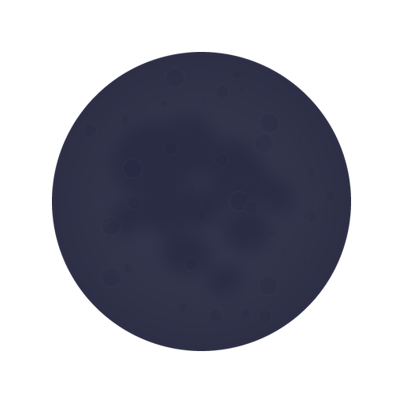
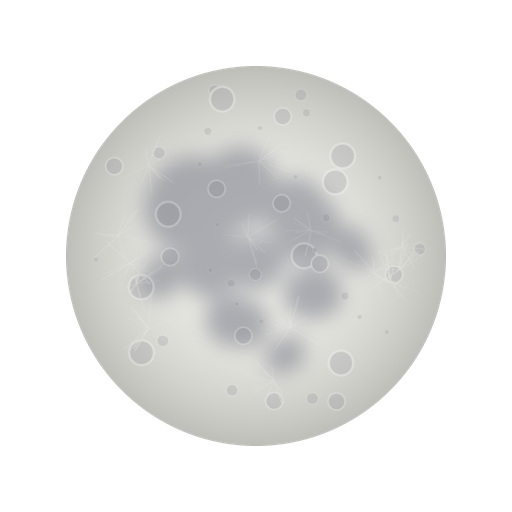

---

---

</a>

- 
- 
- 
- 
- 
- 

---

</a>

---

</a>

  

  
  

  
  
  
  
  
  

---

##  Стек и инструменты

### Языки

  

### Фреймворки и платформы

  

### Инструменты

  

---

## Статистика GitHub

 

---

## Активность

---

## Поддержать

Если мои проекты тебе помогли, можешь поддержать звёздочкой ⭐ на репозитории или рассказать о них друзьям.

  

